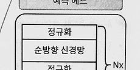
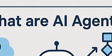

### 🚀 About Me

- 안녕하세요! 백엔드 개발자 권시연 입니다.
- [블로그](https://yeonyeon.tistory.com/), [깃허브](https://github.com/yeon-06) 등 꾸준한 기록 활동을 통해 **꾸준함을 증명**할 수 있습니다.
- **지식을 공유하며 소통**하는 활동을 좋아하여 [글또](https://www.notion.so/ac5b18a482fb4df497d4e8257ad4d516), [MeetCoder](https://github.com/Meet-Coder-Study/posting-review), [한이음](https://www.hanium.or.kr/portal/index.do) 등 20여 개 이상의 스터디 또는 멘토 멘티에 참여 하였습니다.
- **모르는 것을 빠르게 질문**하고, 자신의 의견을 드러내는 것에 불편함이 없습니다.
- 쉽고 간단한 코드가 유지보수하기 좋고 누구든지 이해할 수 있는, 좋은 코드라고 생각합니다.

 

### 📚 Blog
<table><tbody><tr>
<td>
    <a href="https://yeonyeon.tistory.com/367">
         
        
[책 후기] 다시, 소프트웨어 엔지니어 

    </a>
    
저자: 네서니얼 슈타, 댄 배가출판사: 책만책 링크:  사내 독서모임에서 읽은 책이다. 루즈하게 진행되는 모임이다 보...

    
26.11.21

</td>
<td>
    <a href="https://yeonyeon.tistory.com/366">
         
        
[Spring 6] HTTP 인터페이스 

    </a>
    
1. 새로운 HTTP 인터페이스 등장Spring 6 & Spring Boot 3에 도입된 HTTP 서비스 정의 방법을 확인해보자. 이 방식은 ...

    
26.10.12

</td>
<td>
    <a href="https://yeonyeon.tistory.com/365">
         
        
생성형 AI 서비스 설계 과정 정리 

    </a>
    
이 글은 가상 면접 사례로 배우는 생성형 AI 서비스 설계 4장 'ChatGPT: 개인 비서 챗봇'을 읽고 내용을 정리한 글입...

    
26.06.21

</td>
</tr>
<tr>
<td>
    <a href="https://yeonyeon.tistory.com/364">
         
        
Claude Code for Developers 밋업 후기 

    </a>
    
Claude Code 커뮤니티가 주최하는 밋업을 다녀왔다. 일시: 2026-04-30 10:00 ~ 12:00형식: 발표 4 세션 + 네트워킹 Q&...

    
26.05.02

</td>
<td>
    <a href="https://yeonyeon.tistory.com/363">
         
        
AI 에이전트란? 

    </a>
    
개요 이 글은 AI 에이전트에서 사용되는 기본적인 용어들을 간단하게 정리하는 글입니다. 이미 에이전트를 개발하고 ...

    
26.03.30

</td>
<td>
    <a href="https://yeonyeon.tistory.com/362">
         
        
토스 러너스하이 서버 2기 후기 - 한 달 동안 얻은 인사이트 

    </a>
    
✏️ 서론 지난 12월 ~ 1월에 진행했던 토스 러너스하이를 이제야 후기를 작성한다. 급한 회사 일을 마무리하고 리프레...

    
26.03.12

</td>
</tr>
</tbody></table>